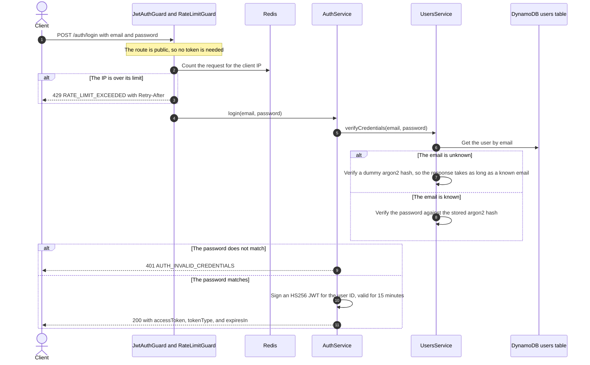
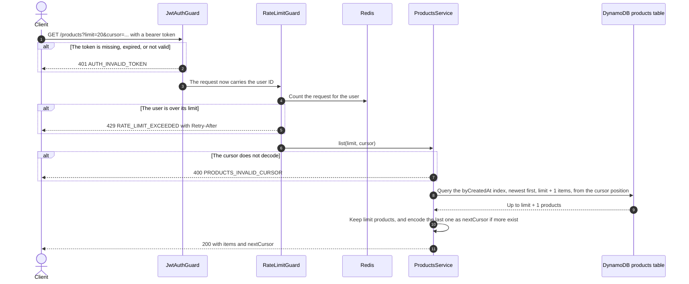
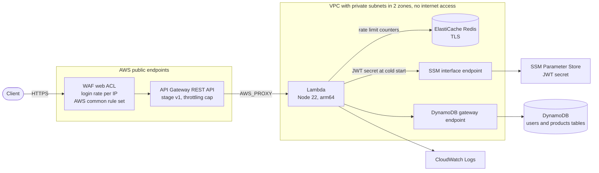

# Request flows

These diagrams show how the Product API handles a login and a product list request, and how it runs on AWS. The routes and their responses are in [openapi.json](openapi.json).

## Every request passes the same checks

The app runs the same steps, in the same order, for every route:

1. `JwtAuthGuard` checks the bearer token. A route marked `@Public()`, such as `/auth/login`, skips the check.
2. `RateLimitGuard` counts the request in Redis. It counts by user when the request has a valid token, and by IP when it has none. `/health` is not counted.
3. The `ValidationPipe` checks the body and the query.
4. The controller calls the service.
5. `AllExceptionsFilter` turns any error into a JSON body with a `statusCode`, a `code`, and a `message`.

A request with a missing or bad token gets a 401 at step 1, so it never uses up a rate limit budget.

## Log in

A failed login counts against the IP budget like a successful one. The default budget is 5 logins a minute for each IP.

## List products

To read the next page, the client sends `nextCursor` back as `cursor`. The last page has a `nextCursor` of `null`. Each user has one budget for all routes, 60 requests a minute by default.

## AWS architecture

A request passes three rate limits on AWS:

1. WAF blocks an IP that sends more than 100 logins in 5 minutes.
2. API Gateway accepts up to 100 requests a second for the whole API.
3. The app limits each user and each IP in Redis.

The Lambda reaches DynamoDB and SSM through VPC endpoints, because its subnets have no route to the internet. The Terraform for these resources is in [infra/](../infra/README.md).
